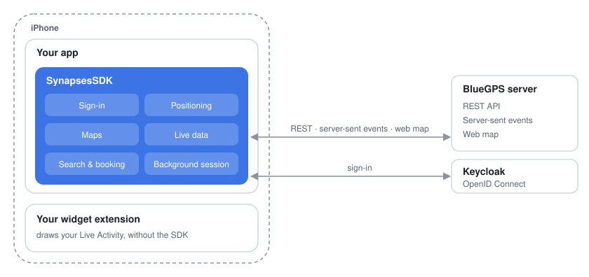
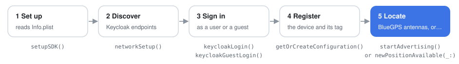
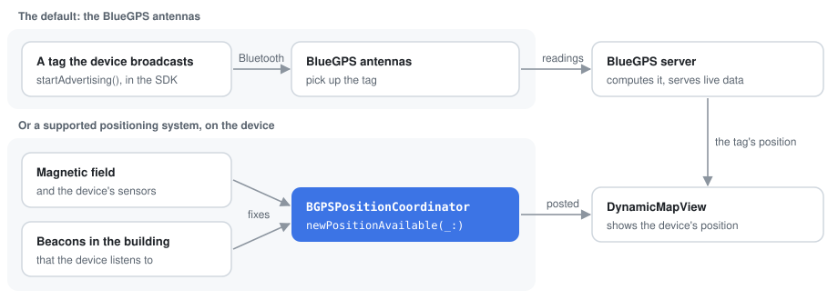
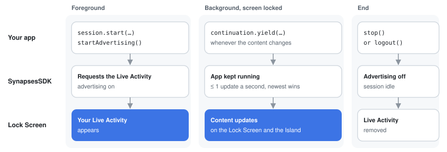

# SynapsesSDK 3.0.1

Indoor positioning, maps and facility services from BlueGPS, for iOS 17.0 and later.

| | |
|---|---|
| **Swift package** | `https://github.com/synapseslab/ios-bluegps-sdk-public`, version `3.0.1` |
| **Binary** | [`xcframework.zip`](https://github.com/synapseslab/ios-bluegps-sdk-public/releases/download/3.0.1/xcframework.zip), the XCFramework the package downloads |
| **Documentation** | [The SDK's documentation](https://synapseslab.com/ios-bluegps-sdk-public/documentation/synapsessdk/): guides and every symbol |
| **Sample app** | [`BlueGPS-SampleApp-3.0.1.zip`](https://github.com/synapseslab/ios-bluegps-sdk-public/releases/download/3.0.1/BlueGPS-SampleApp-3.0.1.zip), the source of a SwiftUI app that uses the SDK |
| **What changed** | [CHANGELOG](CHANGELOG.md) |

## What it does

- **Sign-in** through Keycloak, as a user or as a guest.
- **Positioning**: by default with the BlueGPS antennas, which pick up the Bluetooth tag
  the device broadcasts, or with another supported positioning system that computes the
  position on the device.
- **Maps**: the building, the device's position, search and directions, in a `DynamicMapView`.
- **Live data**: positions, rooms, areas and events as the BlueGPS server computes them.
- **Background sessions**: the device keeps broadcasting its tag with the screen locked,
  behind a Live Activity of your own.
- **Facility services**: resources, booking, tickets, visitors and more, each a method on
  `BlueGPS.shared`.

<picture>
  <source media="(prefers-color-scheme: dark)" srcset="images/architecture-dark.svg">
  
</picture>

## Requirements

- iOS 17.0 or later.
- Xcode 27.2 (Swift 6.4.2) or later, the version this release is built with.
- A BlueGPS installation. Its server, Keycloak realm and client IDs come from Synapses
  support.

## Installation

In Xcode, choose **File › Add Package Dependencies…** and enter `https://github.com/synapseslab/ios-bluegps-sdk-public`. In a
package manifest:

```swift
dependencies: [
    .package(url: "https://github.com/synapseslab/ios-bluegps-sdk-public", from: "3.0.1"),
],
targets: [
    .target(name: "MyApp", dependencies: [
        .product(name: "ios-bluegps-sdk-public", package: "ios-bluegps-sdk-public"),
    ]),
]
```

Then `import SynapsesSDK`.

## Quick start

<picture>
  <source media="(prefers-color-scheme: dark)" srcset="images/getting-started-dark.svg">
  
</picture>

Describe your installation in `Info.plist`, under a `SynapsesSDK` dictionary: the server
in `defaultURL`, and the Keycloak settings in `KeycloakConfig`. Declare the scheme of your
redirect URI in `CFBundleURLTypes`. [Getting Started](https://synapseslab.com/ios-bluegps-sdk-public/documentation/synapsessdk/gettingstarted) lists
every key.

```swift
import SynapsesSDK

BlueGPS.setupSDK()                                    // 1 reads Info.plist, at launch
try await BlueGPS.shared.networkSetup()               // 2 discovers Keycloak
_ = try await BlueGPS.shared.keycloakLogin()          // 3 or keycloakGuestLogin()
let tagId = try await BlueGPS.shared
    .getOrCreateConfiguration().iosadvConf.tagid      // 4 the device's tag, its identity
// 5 locate the device: see Positioning
```

Signing out with `logout()` stops everything the SDK runs for the user.

## Positioning

BlueGPS locates the device with its own antennas by default. Installed in the building,
they pick up the Bluetooth tag the device broadcasts, in the background too, and the
BlueGPS server computes the position. BlueGPS also works with other positioning systems
compatible with it, which compute the position on the device: from the building's
magnetic field and the device's sensors, or from the beacons installed in the building.

<picture>
  <source media="(prefers-color-scheme: dark)" srcset="images/positioning-dark.svg">
  
</picture>

**The BlueGPS antennas.** SynapsesSDK broadcasts the device's tag over Bluetooth, the
antennas pick it up and the BlueGPS server computes the position. Add
`NSBluetoothAlwaysUsageDescription` to `Info.plist`, then:

```swift
try await BlueGPS.shared.startAdvertising()
```

`BlueGPS.shared.advertising` is observable and says where advertising stands.

**A supported positioning system on the device.** It runs in your app, with its own SDK,
and your app hands each fix to SynapsesSDK:

```swift
let fix = BGPGPSPosition(tagid: tagId,
                         positionTS: Date().timeIntervalSince1970 * 1000,
                         latitude: latitude, longitude: longitude, floorLevel: floor)
BGPSPositionCoordinator.shared.newPositionAvailable(fix)
```

Either way the map shows the position. Map coordinates, heading and reporting to the
server: [Positioning](https://synapseslab.com/ios-bluegps-sdk-public/documentation/synapsessdk/positioning).

> **In the background.** iOS suspends an app soon after it leaves the foreground. If the
> device must stay located with the screen locked, a [background session](#background-sessions)
> keeps the app running while the device broadcasts its tag to the BlueGPS antennas.
> Bluetooth keeps working with the screen locked from iOS 26.

## Maps

`DynamicMapView` shows the building's web map. Load it with the device's tag, follow its
events through a `DynamicMapViewDelegate`, and drive it with commands: floors, rotation,
following a tag, selecting a search result, directions.

```swift
let mapView = DynamicMapView(frame: .zero)
mapView.load("/api/public/resource/sdk/v1/mobile.html",
             configuration: ConfigurationModel(tagid: tagId, show: ShowModel(me: true)),
             delegate: self)

let rooms = try await BlueGPS.shared.findResource("meeting")
mapView.selectPoi(poi: rooms.first, changeFloor: true)
```

How to show it in SwiftUI, and every command: [Maps](https://synapseslab.com/ios-bluegps-sdk-public/documentation/synapsessdk/maps).

## Live data

Read a tag's position once, or follow it, its rooms and your installation's events as
server-sent event streams. A stream lasts as long as you keep its `SSEManager`.

```swift
let position = try await BlueGPS.shared.getCurrentPosition(tagId)

stream = BlueGPS.shared.startNotifyPositionChanges(with: [tagId], onValueChanged: { positions in
    // The newest positions of each tag.
})
```

Rooms, areas, events and beacon tracking: [Live Data](https://synapseslab.com/ios-bluegps-sdk-public/documentation/synapsessdk/livedata).

## Background sessions

iOS suspends an app soon after it leaves the foreground, and the tag it broadcasts with
it. A background session keeps the app running while a Live Activity of yours is on
screen.

<picture>
  <source media="(prefers-color-scheme: dark)" srcset="images/background-session-dark.svg">
  
</picture>

```swift
let session = BlueGPS.shared.backgroundSession
let (updates, continuation) = AsyncStream.makeStream(of: TrackingAttributes.ContentState.self)

session.start(TrackingAttributes(symbol: "figure.walk"),
              initial: .init(title: "Calculating the route…", subtitle: "Room 3", progress: 0),
              updates: updates)
try await BlueGPS.shared.startAdvertising()

// Whenever what the Live Activity shows changes
continuation.yield(.init(title: "Turn left · 12 m", subtitle: "Room 3 · 45 m", progress: 0.38))

// When it ends: the Live Activity goes, and advertising stops
await session.stop()
```

The Live Activity is yours: its `ActivityAttributes` type, which must be `Sendable`, its
content and the widget extension that draws it, without the SDK. The app declares the
`bluetooth-central` and `bluetooth-peripheral` background modes and
`NSSupportsLiveActivities`. Setup, monitoring and the limits to evaluate before shipping:
[Background Sessions](https://synapseslab.com/ios-bluegps-sdk-public/documentation/synapsessdk/backgroundsessions).

## Sample app

A SwiftUI app that uses the SDK the way an integrator would, one feature per file:
sign-in, tag advertising, a background session with its Live Activity, the map with
search, floors and directions, areas, room and position monitoring, and a log. Put your
installation's values in its `Config/Sample.xcconfig`, then build and run on a device.
Its source is attached to every release:
[`BlueGPS-SampleApp-3.0.1.zip`](https://github.com/synapseslab/ios-bluegps-sdk-public/releases/download/3.0.1/BlueGPS-SampleApp-3.0.1.zip).

## Documentation

| To | Read |
|---|---|
| Configure the SDK, sign in, register the device | [Getting Started](https://synapseslab.com/ios-bluegps-sdk-public/documentation/synapsessdk/gettingstarted) |
| Locate the device, with the BlueGPS antennas or another supported system | [Positioning](https://synapseslab.com/ios-bluegps-sdk-public/documentation/synapsessdk/positioning) |
| Show maps, search and directions | [Maps](https://synapseslab.com/ios-bluegps-sdk-public/documentation/synapsessdk/maps) |
| Follow positions, rooms, areas and events | [Live Data](https://synapseslab.com/ios-bluegps-sdk-public/documentation/synapsessdk/livedata) |
| Keep the device visible with the screen locked | [Background Sessions](https://synapseslab.com/ios-bluegps-sdk-public/documentation/synapsessdk/backgroundsessions) |
| Rely on what the decoded models contain | [Working with the models](https://synapseslab.com/ios-bluegps-sdk-public/documentation/synapsessdk/workingwithmodels) |
| Find any other method: booking, tickets, visitors… | [`BlueGPS`](https://synapseslab.com/ios-bluegps-sdk-public/documentation/synapsessdk/bluegps) |

## Upgrading from 2.0

- If your dependency rule starts from 5.0.0, change it to *Up to Next Major Version* from
  3.0.1. The tag `v5.0.0` carried 2.0.109 and has been removed.
- Rebuild your app against this version: some methods changed their binary interface.
- iOS 17 is the minimum.
- `startAdvertisingRegion` and `stopAdvertisingRegion` are deprecated: use
  `startAdvertising(configuration:)`, `stopAdvertising()` and the `advertising` state.
- `logout()` and `localLogout()` stop the background session, advertising and beacon
  tracking.

Every change, with what it means for your code: [CHANGELOG](CHANGELOG.md).
